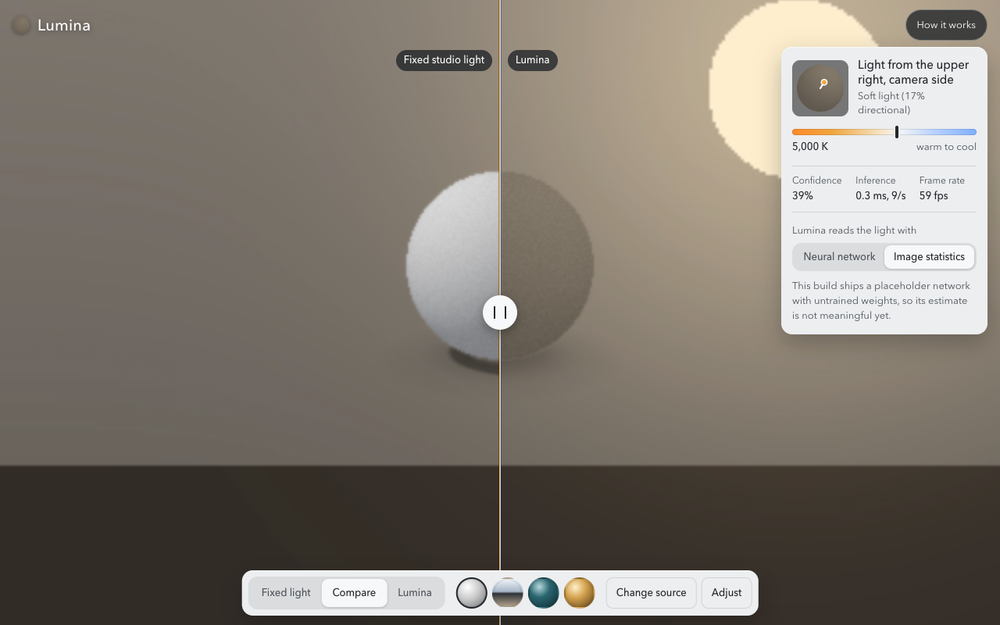

# Lumina

Live demo: https://television05.github.io/lumina/

Lumina estimates the lighting of a room from one webcam frame and uses it to light a 3D object. A
small convolutional network (1.59 M parameters, 6.4 MB) regresses nine spherical-harmonic RGB
coefficients from a 96 x 128 frame. The network runs in your browser with onnxruntime-web, and
three.js turns the coefficients into a LightProbe, a derived DirectionalLight and a shadow catcher,
smoothed over time with a One Euro filter. Move a lamp and the object's shading, colour cast and
shadow follow it.



## Try it

Open the demo, press "Use my camera" (or drop a photo or video on the page, or use the bundled
sample clip). Tested only in headless Chromium. WebGPU is used when available,
otherwise single-thread WASM; no special server headers are required.

## Run it locally

```sh
uv sync                                    # Python 3.12 venv in .venv
uv run pytest                              # Python tests (100)

cd web
npm ci
npm run lint && npm run format:check && npm run typecheck
npm test                                   # vitest (132 tests)
npx playwright install chromium            # once
npm run e2e                                # headless Chromium with a fake camera, never the real one
npm run e2e:dist                           # production build served under /lumina/ like Pages
npm run dev                                # http://localhost:5179/lumina/
```

Retrain and re-evaluate: `uv run python -m lumina_train.train`, then `uv run python -m
lumina_train.evaluate` (needs the HDRIs, see `docs/DATA.md`). The training/web contract is
`docs/CONVENTIONS.md`; the app is described in `docs/WEB.md`.

## How well does it work

**Honest summary: the shipped model is an early, short training run and only a modest improvement
over simple baselines.** It was trained for 2,000 steps (0.13 h on one laptop GPU), well short of
the 50,000-step run its command records. All numbers are from `eval/results.json`, generated
2026-11-13, on 103 held-out Poly Haven HDRIs (1,545 synthetic crops), mean over HDRIs with 95 %
bootstrap CIs over HDRIs. Lower is better. Full tables and failure cases: `docs/EVAL.md`.

| Method                          | RMSE (linear)        | sRGB RMSE (8-bit levels) | Colour error (deg) | Direction error, directional scenes (deg) |
| ------------------------------- | -------------------- | ------------------------ | ------------------ | ----------------------------------------- |
| Lumina CNN                      | 1.061 [0.577, 1.841] | 61.9 [59.1, 64.7]        | 13.0 [12.5, 13.6]  | 53.2 [48.8, 57.6]                         |
| Training-set mean lighting      | 1.405 [0.962, 2.148] | 99.7 [95.2, 104.2]       | 18.9 [18.2, 19.5]  | 53.1 [47.8, 58.3]                         |
| Image-mean colour, ambient only | 1.099 [0.611, 1.885] | 70.5 [65.2, 75.5]        | 8.7 [7.9, 9.7]     | 90.0 (no direction)                       |

- Clear wins over the training-set mean: sRGB RMSE and colour error (CIs do not overlap).
- Linear RMSE is lower than every baseline, but the CIs overlap: not a clear win.
- Dominant-light direction is **not better** than the training-set mean.
- Plain image-mean colour has a **better colour error** than the CNN.
- On 48 out-of-distribution ambientCG HDRIs the picture is the same (CNN RMSE 0.923
  [0.665, 1.226], sRGB RMSE 62.8 against 86.8 for the training mean).

## Limits

- Every number above is on synthetic camera crops of HDRIs. **Accuracy on real webcams has not been
  measured**; there is no real-photo test set with ground-truth lighting.
- Estimates are relative to the frame's exposure: absolute brightness is not recoverable.
- Nine spherical-harmonic coefficients are low frequency: hard shadows and sharp highlights are
  not represented.
- Dominant-light direction is weak (about 53 degrees mean error on directional scenes).
- Browser speed (headless software rendering, WASM): about 10 ms per inference; real GPUs differ.

## Privacy

Camera frames stay on your device. The frame is read into a canvas, resized to 128 x 96 and fed to
the network inside a Web Worker in your browser. The only network request the app makes is the
one-off download of its own files (page, scripts, WASM and `lumina-sh.onnx`) from the same origin.
No frame, estimate or analytics is sent anywhere. This is checked by `web/e2e/privacy.spec.ts`,
which fails if a camera session makes any request to another origin, any non-GET request or any
request with a body, and the only network call in the source is the model fetch in
`web/src/estimators/neural.worker.ts`.

## Licence and attribution

MIT, see `LICENSE`. The weights are trained only on CC0 data. Training and test HDRIs come from
[Poly Haven](https://polyhaven.com/hdris) (CC0) and, for the out-of-distribution test only,
[ambientCG](https://ambientcg.com) (CC0); the sample clips are rendered from four Poly Haven
test HDRIs (ticknock_02, storeroom, snowy_forest_path_02, hochsal_field). Thanks to their artists.
Full list: `CREDITS.md`, `docs/DATA.md`.
