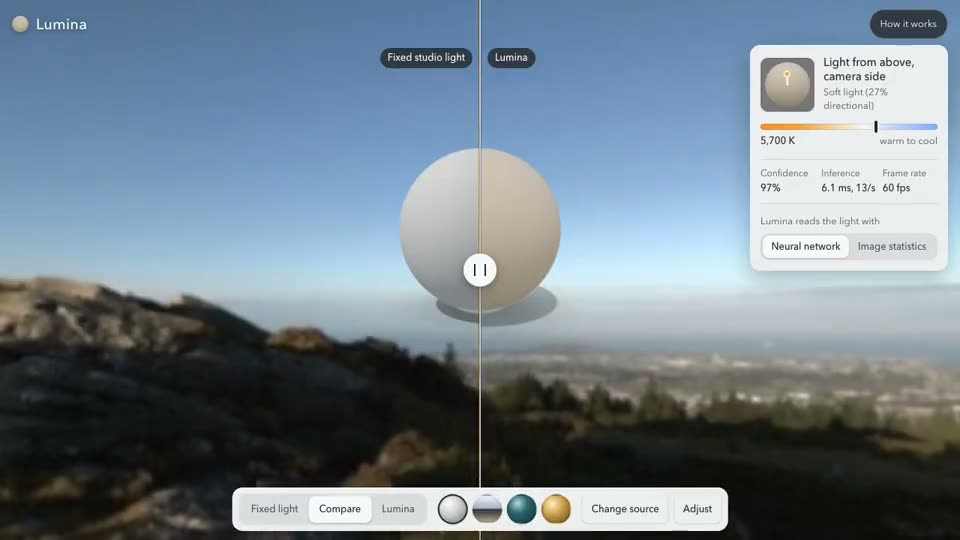

# Lumina

Live demo: https://television05.github.io/lumina/

Lumina estimates the lighting of a room from one webcam frame and uses it to light a 3D object. A
small convolutional network (1.59 M parameters, 6.4 MB) regresses nine spherical-harmonic RGB
coefficients from a 96 x 128 frame. The network runs in your browser with onnxruntime-web, and
three.js turns the coefficients into a LightProbe, a derived DirectionalLight and a shadow catcher,
smoothed over time with a One Euro filter. Move a lamp and the object's shading, colour cast and
shadow are meant to follow it. How well that works is measured below and is modest: the colour
cast follows the scene, the light direction only weakly.

[](docs/media/lumina-demo.mp4)

The demo clip (`docs/media/lumina-demo.mp4`, 13 s) was recorded headless from the bundled synthetic
sample clips played as a fake camera: the left half of the ball uses a fixed studio light, the right
half uses Lumina's estimate. The picture is a rendered panorama, not a real room.

## Try it

Open the demo, press "Use my camera" (or drop a photo or video on the page, or use the bundled
sample clip). Tested only in headless Chromium (no real camera was used). WebGPU is used when available,
otherwise single-thread WASM; no special server headers are required.

## Run it locally

```sh
uv sync                                    # Python 3.12 venv in .venv
uv run pytest                              # Python tests (100)

cd web
npm ci
npm run lint && npm run format:check && npm run typecheck
npm test                                   # vitest (132 tests)
npx playwright install chromium            # once
npm run e2e                                # headless Chromium with a fake camera, never the real one
npm run e2e:dist                           # production build under /lumina/ like Pages, plus the truth test
                                           # (needs ffmpeg and uv on PATH)
npm run dev                                # http://localhost:5179/lumina/
```

Retrain and re-evaluate: `uv run python -m lumina_train.train`, then `uv run python -m
lumina_train.evaluate` (needs the HDRIs, see `docs/DATA.md`). The training/web contract is
`docs/CONVENTIONS.md`; the app is described in `docs/WEB.md`.

## How well does it work

**Honest summary: the shipped model is an early, short training run and only a modest improvement
over simple baselines.** It was trained for 2,000 steps (0.13 h on one laptop GPU), well short of
the 50,000-step run its command records. All numbers are from `eval/results.json`, generated
2026-11-13, on 103 held-out Poly Haven HDRIs (1,545 synthetic crops), mean over HDRIs with 95 %
bootstrap CIs over HDRIs. Lower is better. Full tables and failure cases: `docs/EVAL.md`.

| Method                                         | RMSE (linear)        | si-RMSE (linear)     | sRGB RMSE (8-bit levels) | Colour error (deg) | Direction error, directional scenes (deg) |
|---|---|---|---|---|---|
| Lumina CNN | 1.061 [0.577, 1.841] | 0.583 [0.331, 0.988] | 61.9 [59.1, 64.7] | 13.0 [12.5, 13.6] | 53.2 [48.8, 57.6] |
| Training-set mean lighting | 1.405 [0.962, 2.148] | 0.673 [0.384, 1.141] | 99.7 [95.2, 104.2] | 18.9 [18.2, 19.5] | 53.1 [47.8, 58.3] |
| Image-mean colour, ambient only | 1.099 [0.611, 1.885] | 0.613 [0.364, 1.012] | 70.5 [65.2, 75.5] | 8.7 [7.9, 9.6] | 90.0 (no direction) |
| Image-mean colour + brightest-region direction | 1.157 [0.668, 1.943] | 0.939 [0.516, 1.638] | 109.5 [103.4, 115.3] | 8.7 [7.9, 9.6] | 79.9 [75.7, 84.2] |

- Clear wins over the training-set mean: sRGB RMSE and colour error (CIs do not overlap).
- Linear RMSE is lower than every baseline, but the CIs overlap: not a clear win.
- Dominant-light direction is **not better** than the training-set mean (it is clearly better than
  the brightest-region heuristic baseline, 53.2 against 79.9 degrees).
- Plain image-mean colour has a **better colour error** than the CNN.
- On 48 out-of-distribution ambientCG HDRIs the picture is the same (CNN RMSE 0.923
  [0.665, 1.226], sRGB RMSE 62.8 against 86.8 for the training mean).

## Limits

- Every number above is on synthetic camera crops of HDRIs. **Accuracy on real webcams has not been
  measured**; there is no real-photo test set with ground-truth lighting.
- Estimates are relative to the frame's exposure: absolute brightness is not recoverable.
- Nine spherical-harmonic coefficients are low frequency: hard shadows and sharp highlights are
  not represented.
- Dominant-light direction is weak (about 53 degrees mean error on directional scenes).
- Browser speed, measured with the shipped model (`npm run perf`, 2026-11-13, Apple M2 Max, load
  average about 30 from other jobs, headless Chromium, synthetic camera at 12 inferences per second):
  network inference 4.2 to 4.3 ms median (p95 4.4 to 5.0) on single-thread WASM with software
  WebGL, and 5.2 to 5.8 ms median (p95 6.2 to 7.9) on WebGPU with the Metal GPU. Frame interval
  16.7 ms on the GPU. Software rendering is much slower (frame interval p95 50 to 69 ms) and the app
  lowers its render scale to cope. Other machines and real GPUs will differ. Details: `docs/WEB.md`.

## Tests that prove it

`web/e2e/truth.spec.ts` plays a sample clip with known lighting per frame as the fake camera in the
production build and checks (numbers from the run of 2026-11-13; run `npm run e2e:dist` to reproduce):

- the 128 x 96 frames the network sees match an independent ffmpeg resize (median 3.5 levels of
  255 apart), and the network's output in the browser equals Python onnxruntime on those very
  frames (largest difference 2.4e-7, so preprocessing and graph agree with the Python side);
- as the environment turns 360 degrees, the estimated light azimuth sweeps the same way as the true
  one (agreement 0.54 to 0.58 against 0.09 to 0.21 for the reversed sweep, median direction error 44 to 51
  degrees over four runs,
  so it follows the light but is not accurate), the displayed estimate trails the network by about
  170 to 250 ms, and the lit probe ball's bright side matches the estimated side in 100 % of samples and
  the true side in 96 % (stable across runs).

The test was mutation-checked: pairing frames with the reversed truth makes it fail.

## Privacy

Camera frames stay on your device. The frame is read into a canvas, resized to 128 x 96 and fed to
the network inside a Web Worker in your browser. The only network request the app makes is the
one-off download of its own files (page, scripts, WASM and `lumina-sh.onnx`) from the same origin.
No frame, estimate or analytics is sent anywhere. This is checked by `web/e2e/privacy.spec.ts`,
which fails if a camera session makes any request to another origin, any non-GET request or any
request with a body, and the only network call in the source is the model fetch in
`web/src/estimators/neural.worker.ts`.

## Licence and attribution

MIT, see `LICENSE`. The weights are trained only on CC0 data. Training and test HDRIs come from
[Poly Haven](https://polyhaven.com/hdris) (CC0) and, for the out-of-distribution test only,
[ambientCG](https://ambientcg.com) (CC0); the sample clips are rendered from four Poly Haven
test HDRIs (ticknock_02, storeroom, snowy_forest_path_02, hochsal_field). Thanks to their artists.
Full list: `CREDITS.md`, `docs/DATA.md`.
