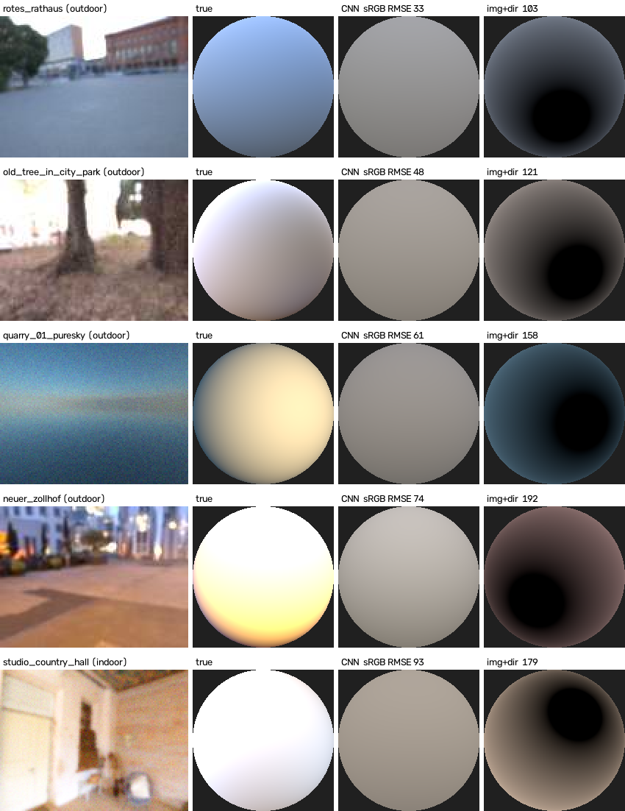

# Evaluation

Generated by `uv run python -m lumina_train.evaluate` on 2026-11-14 for `web/public/models/lumina-sh.onnx` (6,439,046 bytes, sha256 `bb56593b7480e348bd396f5cfb9d8fc4d91c59114118d629496ca4d5a4d10fe3`). Every number below is in `eval/results.json`; re-running the command reproduces them from the fixed crop list `eval/test_crops.json` and the fixed bootstrap seed. Setup: docs/DATA.md.

## Read this first

- **The shipped weights are an early snapshot**: the EMA weights at step 2000 of a 50,000-step schedule (see Training below), not a converged model.
- **The network's output barely varies.** On the 1,545 test crops the total variance of its predicted SH coefficients is 0.006 % of the label variance, the per-coefficient correlation with the truth is 0.01 to 0.21, and R2 against the label mean is -0.007 (0 means no better than always answering the average). In the demo this means the lighting it applies is close to a fixed average that shifts a little with brightness and colour cast; it does not reconstruct the structure of the room's light. The small direction signal that exists is enough to follow a light sweeping round, not to place it accurately.
- **Everything here is on synthetic crops of CC0 panoramas.** Accuracy on real webcams has not been measured.

| SH coefficient | Label std | Prediction std | Correlation (green) |
|---|---|---|---|
| 0 | 19.29 | 0.31 | 0.19 |
| 1 | 6.59 | 0.14 | 0.19 |
| 2 | 25.45 | 0.13 | 0.04 |
| 3 | 16.16 | 0.07 | 0.05 |
| 4 | 4.39 | 0.07 | 0.21 |
| 5 | 12.28 | 0.12 | 0.07 |
| 6 | 27.71 | 0.05 | 0.01 |
| 7 | 20.34 | 0.05 | 0.02 |
| 8 | 14.55 | 0.08 | 0.05 |

Rows are the SH basis order of docs/CONVENTIONS.md; std is over the test crops, mean over RGB; correlation is over the test crops for the green channel. Produced by `output_spread` in `training/lumina_train/evaluate.py`.

## Summary

Generated from the paired per-HDRI differences (CNN minus baseline, 95 % bootstrap CI), all scenes. 'Better' means the whole CI is below zero.

- **Held-out Poly Haven test**: better than every baseline on RMSE (linear), si-RMSE (linear), sRGB RMSE (8-bit levels). Not better than every baseline on: Colour error (deg) (worse vs image-mean colour, ambient only; worse vs image mean + brightest-region direction), Direction error, directional scenes (deg) (no clear difference vs training-set mean lighting).
- **ambientCG (OOD)**: better than every baseline on RMSE (linear), sRGB RMSE (8-bit levels). Not better than every baseline on: si-RMSE (linear) (no clear difference vs training-set mean lighting), Colour error (deg) (worse vs image-mean colour, ambient only; worse vs image mean + brightest-region direction), Direction error, directional scenes (deg) (worse vs training-set mean lighting).

## What is measured

Each test crop is a synthetic camera frame (same camera model as training, docs/DATA.md) of a
held-out HDRI. Its true label is the HDRI's SH9 in that camera's frame at that frame's exposure
and white balance. Every method predicts SH9 from the 128 x 96 frame alone, and both SH are
compared through a rendered sphere: Lambertian, albedo 0.5, 64 x 64, orthographic view down -Z
(the side the camera sees), linear radiance albedo / pi * E(n) (docs/CONVENTIONS.md section 3).

| Metric | Definition |
|---|---|
| RMSE | root mean square difference over sphere pixels and RGB, linear, frame exposure |
| si-RMSE | the same after scaling the prediction by the best scalar (shape and colour only) |
| sRGB RMSE | after clipping to [0, 1] and the sRGB curve, in 8-bit levels: what a screen shows |
| Colour error | angle between the mean RGB of the predicted and true spheres (colour cast) |
| Direction error | angle between dominant-light directions (luminance band 1, CONVENTIONS s. 6) |

Direction error is reported separately for **directional** crops (true directionality at least
0.3) and **diffuse** crops (below it), where a dominant direction hardly exists and the
number is close to meaningless; it is listed only to be complete.

Baselines, scored by the same code:

- **Training-set mean lighting**: the mean label over 8 seeded crops of every training HDRI.
- **Image-mean colour, ambient only**: the frame's mean colour (sRGB decoded) as a uniform
  environment (grey-world style); it has no direction.
- **Image mean + brightest-region direction**: the same plus a band-1 term toward the
  luminance-weighted centroid of the brightest 2 % of pixels (pinhole with an assumed 60 degree
  vertical FOV), with the training-set mean directionality (0.545).

Each cell is the mean over HDRIs (each HDRI's crops averaged first) with a 95 % percentile
bootstrap CI over HDRIs (2000 resamples, seed 4004). Lower is better everywhere.

## Held-out Poly Haven test split

103 HDRIs (31 indoor, 72 outdoor), 1545 crops.

### All scenes

| Method | RMSE (linear) | si-RMSE (linear) | sRGB RMSE (8-bit levels) | Colour error (deg) | Direction error, directional scenes (deg) | Direction error, diffuse scenes (deg) |
|---|---|---|---|---|---|---|
| LuminaNet (CNN) | 1.061 [0.577, 1.841] | 0.583 [0.331, 0.988] | 61.9 [59.1, 64.7] | 13.0 [12.5, 13.6] | 53.2 [48.8, 57.6] | 66.7 [51.2, 84.7] |
| Training-set mean lighting | 1.405 [0.962, 2.148] | 0.673 [0.384, 1.141] | 99.7 [95.2, 104.2] | 18.9 [18.2, 19.5] | 53.1 [47.8, 58.3] | 64.9 [48.6, 84.0] |
| Image-mean colour, ambient only | 1.099 [0.611, 1.885] | 0.613 [0.364, 1.012] | 70.5 [65.2, 75.5] | 8.715 [7.873, 9.650] | 90.0 [90.0, 90.0] | 90.0 [90.0, 90.0] |
| Image mean + brightest-region direction | 1.157 [0.668, 1.943] | 0.939 [0.516, 1.638] | 109.5 [103.4, 115.3] | 8.715 [7.873, 9.650] | 79.9 [75.7, 84.2] | 76.8 [63.9, 90.3] |

Paired comparison, CNN minus baseline (negative = the CNN is better), per-HDRI difference with its 95 % bootstrap CI; the verdict is generated from the CI:

| CNN minus | RMSE (linear) | si-RMSE (linear) | sRGB RMSE (8-bit levels) | Colour error (deg) | Direction error, directional scenes (deg) |
|---|---|---|---|---|---|
| Training-set mean lighting | -0.344 [-0.404, -0.284] better | -0.090 [-0.154, -0.049] better | -37.7 [-43.7, -31.9] better | -5.819 [-6.253, -5.312] better | +0.095 [-2.023, +2.188] no clear difference |
| Image-mean colour, ambient only | -0.038 [-0.049, -0.026] better | -0.030 [-0.044, -0.014] better | -8.517 [-11.756, -5.055] better | +4.325 [+3.575, +5.117] **WORSE** | -36.8 [-41.2, -32.4] better |
| Image mean + brightest-region direction | -0.095 [-0.109, -0.081] better | -0.357 [-0.652, -0.178] better | -47.5 [-52.3, -42.6] better | +4.325 [+3.575, +5.117] **WORSE** | -26.7 [-33.6, -20.0] better |

### Indoor

| Method | RMSE (linear) | si-RMSE (linear) | sRGB RMSE (8-bit levels) | Colour error (deg) | Direction error, directional scenes (deg) | Direction error, diffuse scenes (deg) |
|---|---|---|---|---|---|---|
| LuminaNet (CNN) | 0.618 [0.329, 1.085] | 0.292 [0.166, 0.483] | 56.8 [51.7, 62.4] | 11.6 [11.2, 12.1] | 66.2 [57.1, 74.6] | 62.4 [42.8, 84.5] |
| Training-set mean lighting | 1.080 [0.854, 1.474] | 0.363 [0.217, 0.575] | 102.4 [94.5, 109.5] | 17.5 [16.6, 18.3] | 65.4 [55.1, 75.2] | 52.7 [34.8, 74.1] |
| Image-mean colour, ambient only | 0.633 [0.334, 1.112] | 0.298 [0.167, 0.501] | 60.1 [50.8, 69.8] | 5.943 [4.837, 7.163] | 90.0 [90.0, 90.0] | 90.0 [90.0, 90.0] |
| Image mean + brightest-region direction | 0.697 [0.397, 1.173] | 0.529 [0.308, 0.878] | 101.9 [92.1, 112.4] | 5.943 [4.837, 7.163] | 82.4 [76.4, 89.4] | 59.2 [43.1, 72.8] |

| CNN minus | RMSE (linear) | si-RMSE (linear) | sRGB RMSE (8-bit levels) | Colour error (deg) | Direction error, directional scenes (deg) |
|---|---|---|---|---|---|
| Training-set mean lighting | -0.463 [-0.551, -0.367] better | -0.070 [-0.100, -0.046] better | -45.6 [-55.6, -34.4] better | -5.851 [-6.499, -5.096] better | +0.779 [-2.713, +4.078] no clear difference |
| Image-mean colour, ambient only | -0.016 [-0.036, +0.003] no clear difference | -0.006 [-0.023, +0.011] no clear difference | -3.324 [-9.403, +2.143] no clear difference | +5.660 [+4.614, +6.649] **WORSE** | -23.8 [-32.9, -15.4] better |
| Image mean + brightest-region direction | -0.080 [-0.105, -0.056] better | -0.237 [-0.401, -0.136] better | -45.1 [-53.4, -37.1] better | +5.660 [+4.614, +6.649] **WORSE** | -16.2 [-29.6, -3.4] better |

### Outdoor

| Method | RMSE (linear) | si-RMSE (linear) | sRGB RMSE (8-bit levels) | Colour error (deg) | Direction error, directional scenes (deg) | Direction error, diffuse scenes (deg) |
|---|---|---|---|---|---|---|
| LuminaNet (CNN) | 1.252 [0.628, 2.354] | 0.707 [0.374, 1.305] | 64.2 [61.2, 67.4] | 13.7 [13.0, 14.4] | 48.3 [44.0, 52.8] | 70.5 [48.6, 98.5] |
| Training-set mean lighting | 1.545 [0.967, 2.611] | 0.806 [0.424, 1.486] | 98.5 [93.4, 103.7] | 19.5 [18.7, 20.3] | 48.5 [43.1, 54.0] | 75.6 [51.1, 106.0] |
| Image-mean colour, ambient only | 1.300 [0.668, 2.409] | 0.748 [0.419, 1.333] | 74.9 [69.3, 80.8] | 9.909 [8.942, 10.936] | 90.0 [90.0, 90.0] | 90.0 [90.0, 90.0] |
| Image mean + brightest-region direction | 1.354 [0.720, 2.466] | 1.116 [0.555, 2.115] | 112.7 [106.2, 119.5] | 9.909 [8.942, 10.936] | 79.0 [73.6, 84.2] | 92.2 [80.0, 105.8] |

| CNN minus | RMSE (linear) | si-RMSE (linear) | sRGB RMSE (8-bit levels) | Colour error (deg) | Direction error, directional scenes (deg) |
|---|---|---|---|---|---|
| Training-set mean lighting | -0.293 [-0.357, -0.223] better | -0.099 [-0.193, -0.042] better | -34.3 [-40.6, -27.7] better | -5.805 [-6.359, -5.166] better | -0.161 [-2.648, +2.412] no clear difference |
| Image-mean colour, ambient only | -0.047 [-0.061, -0.033] better | -0.041 [-0.059, -0.018] better | -10.8 [-14.7, -6.7] better | +3.750 [+2.722, +4.732] **WORSE** | -41.7 [-46.0, -37.2] better |
| Image mean + brightest-region direction | -0.102 [-0.118, -0.085] better | -0.409 [-0.832, -0.173] better | -48.6 [-54.0, -42.9] better | +3.750 [+2.722, +4.732] **WORSE** | -30.7 [-38.3, -22.6] better |

### Win rate: share of HDRIs where the CNN's error is lower

| CNN vs | RMSE (linear) | si-RMSE (linear) | sRGB RMSE (8-bit levels) | Colour error (deg) |
|---|---|---|---|---|
| Training-set mean lighting | 90% | 92% | 90% | 95% |
| Image-mean colour, ambient only | 71% | 72% | 66% | 11% |
| Image mean + brightest-region direction | 91% | 98% | 97% | 11% |

### CNN by exposure / white-balance setting

| Setting | RMSE (linear) | si-RMSE (linear) | sRGB RMSE (8-bit levels) | Colour error (deg) | Direction error, directional scenes (deg) |
|---|---|---|---|---|---|
| neutral (+0 EV, 6500 K) | 0.837 [0.438, 1.476] | 0.449 [0.250, 0.771] | 58.1 [54.3, 61.9] | 8.141 [7.167, 9.151] | 52.5 [48.2, 56.7] |
| warm_dark (-1 EV, 3200 K) | 0.509 [0.269, 0.903] | 0.312 [0.156, 0.569] | 61.8 [59.3, 64.3] | 17.5 [16.8, 18.2] | 53.8 [49.4, 58.2] |
| cool_bright (+1 EV, 8500 K) | 1.838 [1.022, 3.153] | 0.986 [0.585, 1.634] | 65.9 [62.2, 69.4] | 13.5 [12.4, 14.6] | 53.4 [48.8, 57.9] |

## Out-of-distribution: ambientCG

48 HDRIs (23 indoor, 25 outdoor), 720 crops.

### All scenes

| Method | RMSE (linear) | si-RMSE (linear) | sRGB RMSE (8-bit levels) | Colour error (deg) | Direction error, directional scenes (deg) | Direction error, diffuse scenes (deg) |
|---|---|---|---|---|---|---|
| LuminaNet (CNN) | 0.923 [0.665, 1.226] | 0.554 [0.391, 0.750] | 62.8 [59.3, 66.7] | 13.4 [12.6, 14.3] | 44.5 [38.1, 51.9] | 71.9 [47.7, 92.6] |
| Training-set mean lighting | 1.118 [0.928, 1.359] | 0.578 [0.422, 0.761] | 86.8 [80.3, 93.1] | 17.6 [16.4, 18.9] | 39.5 [32.6, 47.6] | 71.4 [45.3, 93.3] |
| Image-mean colour, ambient only | 0.990 [0.723, 1.305] | 0.616 [0.428, 0.842] | 79.7 [72.2, 86.8] | 7.519 [6.494, 8.570] | 90.0 [90.0, 90.0] | 90.0 [90.0, 90.0] |
| Image mean + brightest-region direction | 1.058 [0.792, 1.372] | 0.794 [0.584, 1.044] | 124.3 [116.5, 132.1] | 7.519 [6.494, 8.570] | 80.6 [75.7, 85.1] | 88.2 [81.9, 93.5] |

Paired comparison, CNN minus baseline (negative = the CNN is better), per-HDRI difference with its 95 % bootstrap CI; the verdict is generated from the CI:

| CNN minus | RMSE (linear) | si-RMSE (linear) | sRGB RMSE (8-bit levels) | Colour error (deg) | Direction error, directional scenes (deg) |
|---|---|---|---|---|---|
| Training-set mean lighting | -0.196 [-0.286, -0.104] better | -0.024 [-0.049, +0.006] no clear difference | -24.0 [-31.7, -16.1] better | -4.214 [-5.491, -2.833] better | +4.961 [+2.121, +7.612] **WORSE** |
| Image-mean colour, ambient only | -0.067 [-0.085, -0.050] better | -0.062 [-0.095, -0.032] better | -16.9 [-22.1, -12.0] better | +5.907 [+4.931, +6.857] **WORSE** | -45.5 [-51.9, -38.1] better |
| Image mean + brightest-region direction | -0.135 [-0.155, -0.116] better | -0.240 [-0.301, -0.185] better | -61.4 [-67.9, -54.9] better | +5.907 [+4.931, +6.857] **WORSE** | -36.1 [-44.9, -25.9] better |

### Indoor

| Method | RMSE (linear) | si-RMSE (linear) | sRGB RMSE (8-bit levels) | Colour error (deg) | Direction error, directional scenes (deg) | Direction error, diffuse scenes (deg) |
|---|---|---|---|---|---|---|
| LuminaNet (CNN) | 0.849 [0.415, 1.434] | 0.501 [0.224, 0.873] | 60.3 [54.3, 66.8] | 12.9 [11.8, 14.1] | 47.6 [36.4, 60.8] | 66.2 [37.3, 95.1] |
| Training-set mean lighting | 1.129 [0.796, 1.601] | 0.499 [0.248, 0.829] | 90.7 [82.1, 100.4] | 15.4 [13.8, 16.9] | 44.0 [31.6, 58.6] | 65.3 [34.0, 96.7] |
| Image-mean colour, ambient only | 0.897 [0.454, 1.495] | 0.549 [0.237, 0.974] | 72.2 [60.4, 83.8] | 6.217 [4.719, 7.916] | 90.0 [90.0, 90.0] | 90.0 [90.0, 90.0] |
| Image mean + brightest-region direction | 0.971 [0.532, 1.569] | 0.761 [0.405, 1.234] | 118.4 [106.2, 130.2] | 6.217 [4.719, 7.916] | 83.3 [75.8, 90.2] | 85.1 [76.6, 91.4] |

| CNN minus | RMSE (linear) | si-RMSE (linear) | sRGB RMSE (8-bit levels) | Colour error (deg) | Direction error, directional scenes (deg) |
|---|---|---|---|---|---|
| Training-set mean lighting | -0.280 [-0.416, -0.136] better | +0.003 [-0.035, +0.056] no clear difference | -30.4 [-42.4, -18.5] better | -2.506 [-4.235, -0.526] better | +3.600 [+0.161, +6.809] **WORSE** |
| Image-mean colour, ambient only | -0.048 [-0.072, -0.023] better | -0.048 [-0.101, -0.010] better | -11.8 [-18.8, -4.6] better | +6.642 [+5.373, +7.920] **WORSE** | -42.4 [-53.6, -29.2] better |
| Image mean + brightest-region direction | -0.122 [-0.148, -0.092] better | -0.260 [-0.370, -0.172] better | -58.1 [-66.9, -47.8] better | +6.642 [+5.373, +7.920] **WORSE** | -35.7 [-50.1, -18.3] better |

### Outdoor

| Method | RMSE (linear) | si-RMSE (linear) | sRGB RMSE (8-bit levels) | Colour error (deg) | Direction error, directional scenes (deg) | Direction error, diffuse scenes (deg) |
|---|---|---|---|---|---|---|
| LuminaNet (CNN) | 0.991 [0.737, 1.289] | 0.603 [0.445, 0.794] | 65.1 [61.1, 69.5] | 13.9 [12.8, 15.2] | 41.9 [35.2, 50.2] | 81.5 [43.6, 106.0] |
| Training-set mean lighting | 1.109 [0.955, 1.295] | 0.651 [0.489, 0.843] | 83.2 [74.2, 92.6] | 19.7 [18.1, 21.3] | 35.8 [29.2, 44.1] | 81.4 [42.7, 106.4] |
| Image-mean colour, ambient only | 1.075 [0.805, 1.391] | 0.679 [0.492, 0.896] | 86.6 [76.5, 96.1] | 8.718 [7.469, 9.897] | 90.0 [90.0, 90.0] | 90.0 [90.0, 90.0] |
| Image mean + brightest-region direction | 1.138 [0.868, 1.451] | 0.825 [0.630, 1.059] | 129.7 [118.6, 140.2] | 8.718 [7.469, 9.897] | 78.3 [71.9, 84.4] | 93.3 [89.0, 100.8] |

| CNN minus | RMSE (linear) | si-RMSE (linear) | sRGB RMSE (8-bit levels) | Colour error (deg) | Direction error, directional scenes (deg) |
|---|---|---|---|---|---|
| Training-set mean lighting | -0.118 [-0.246, +0.006] no clear difference | -0.048 [-0.076, -0.023] better | -18.1 [-28.8, -7.8] better | -5.785 [-7.307, -3.832] better | +6.074 [+1.655, +10.191] **WORSE** |
| Image-mean colour, ambient only | -0.084 [-0.109, -0.057] better | -0.076 [-0.117, -0.034] better | -21.5 [-28.5, -13.8] better | +5.231 [+3.977, +6.578] **WORSE** | -48.1 [-54.8, -39.8] better |
| Image mean + brightest-region direction | -0.147 [-0.173, -0.118] better | -0.222 [-0.299, -0.154] better | -64.6 [-73.5, -54.7] better | +5.231 [+3.977, +6.578] **WORSE** | -36.4 [-46.6, -24.0] better |

### Win rate: share of HDRIs where the CNN's error is lower

| CNN vs | RMSE (linear) | si-RMSE (linear) | sRGB RMSE (8-bit levels) | Colour error (deg) |
|---|---|---|---|---|
| Training-set mean lighting | 67% | 85% | 75% | 79% |
| Image-mean colour, ambient only | 79% | 71% | 79% | 0% |
| Image mean + brightest-region direction | 94% | 96% | 98% | 0% |

### CNN by exposure / white-balance setting

| Setting | RMSE (linear) | si-RMSE (linear) | sRGB RMSE (8-bit levels) | Colour error (deg) | Direction error, directional scenes (deg) |
|---|---|---|---|---|---|
| neutral (+0 EV, 6500 K) | 0.725 [0.506, 0.983] | 0.438 [0.302, 0.605] | 58.6 [53.4, 63.6] | 9.306 [7.987, 10.829] | 44.3 [38.0, 51.9] |
| warm_dark (-1 EV, 3200 K) | 0.397 [0.278, 0.550] | 0.274 [0.187, 0.380] | 59.0 [55.6, 62.5] | 19.2 [17.7, 20.7] | 45.0 [38.6, 52.4] |
| cool_bright (+1 EV, 8500 K) | 1.647 [1.200, 2.160] | 0.951 [0.674, 1.281] | 70.9 [65.8, 75.8] | 11.8 [10.1, 13.5] | 44.1 [37.7, 51.6] |

## Failure cases

The five test crops with the largest CNN sRGB RMSE. Columns: the input frame, the true sphere, the CNN's sphere, and the image-mean + direction baseline's sphere.

1. `brown_photostudio_06` (indoor, warm_dark): sRGB RMSE 125.2, true directionality 0.49
2. `lapa` (outdoor, warm_dark): sRGB RMSE 124.3, true directionality 0.60
3. `provence_studio` (indoor, neutral): sRGB RMSE 120.7, true directionality 0.28
4. `brown_photostudio_06` (indoor, neutral): sRGB RMSE 119.8, true directionality 0.49
5. `provence_studio` (indoor, cool_bright): sRGB RMSE 117.9, true directionality 0.28

For contrast, five crops at the 10th, 30th, 50th, 70th and 90th percentile of CNN error:

## Training

Command: `uv run python -m lumina_train.train --run main --steps 50000` (seed 7), 2000 steps of 256 samples on Apple M2 Max (MPS), 0.13 h wall clock (0.5 M synthetic crops). Exported weights: the EMA weights at step 2000 (EMA weights at step 2000, a snapshot of the 50,000-step run taken while it was still in progress (not the end of the schedule); no selection on validation). Validation: 816 fixed crops of the 102 validation HDRIs, scored every 1000 steps; the full log is `eval/train_log.jsonl`. Launch command of the run. The weights are its step-2000 EMA snapshot, so --steps 2000 would not reproduce them (the learning-rate schedule is set by --steps). The run continued past this snapshot; later checkpoints were not exported or evaluated for this release.

| Step | Minutes | Val loss | Val si-RMSE | Val sRGB RMSE | Val colour (deg) | Val direction, directional (deg) |
|---|---|---|---|---|---|---|
| 1000 | 4 | 14.861 | 0.795 | 77.6 | 15.11 | 58.8 |
| 2000 | 8 | 5.386 | 0.741 | 67.3 | 12.06 | 54.0 |

## Limits of this evaluation

- The test crops come from the same synthetic camera model as training. They measure
  generalisation to **unseen scenes**, not to real webcams. Real-camera accuracy is UNVERIFIED:
  there is no real-photo test set with ground-truth lighting here.
- Poly Haven skews outdoor and professional; the ambientCG set is a small second source (48
  HDRIs), not a different camera.
- Labels are relative to the frame's exposure: absolute scene brightness is not recoverable and is
  never claimed.
- SH9 is low frequency: hard shadows and sharp highlights are outside what any method here can
  represent, so the true sphere is itself a soft approximation of the scene.
- Numbers from papers (DeepLight, Garon et al.) use other test sets and definitions; they are not
  comparable with these.
- Browser speed is not measured here (the web app's job).
- Possible same-place leakage was checked for `snowy_forest` (train) against
  `snowy_forest_path_01` and `_02` (test): Poly Haven lists different photographers (Adrian
  Kubasa vs Oliksiy Yakovlyev, no GPS for any of them) and the images show different scenes (a
  bare conifer plantation floor vs snow-covered tree-lined paths), so they are not the same
  location and no exclusion was made. `snowy_forest_path_01` and `_02` look like one location and
  are both in test. This is a visual and metadata check, not proof.
