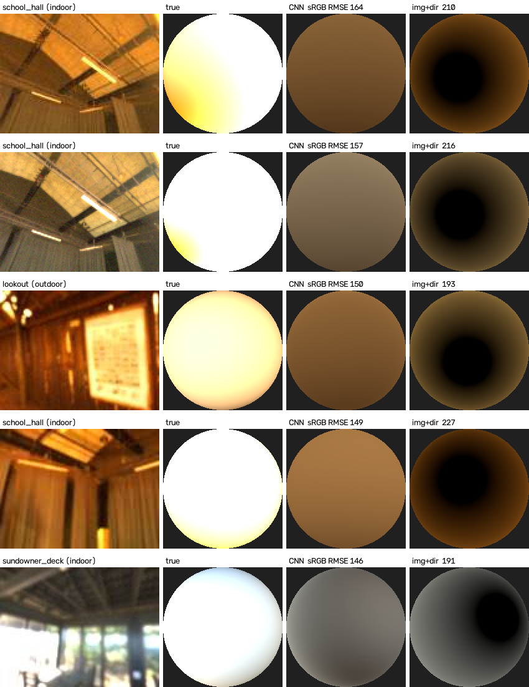
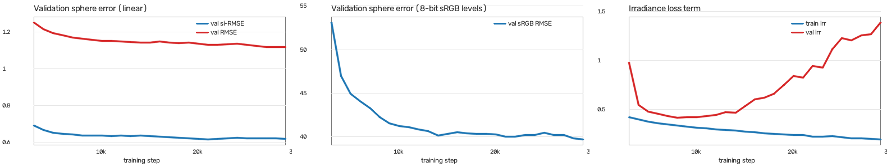

# Evaluation

Generated by `uv run python -m lumina_train.evaluate` on 2026-11-14 for `web/public/models/lumina-sh.onnx` (6,436,208 bytes, sha256 `2abf0185e4f0062da0bfb5f16110e98847fdfff0430393186145291cf1521f6f`). Every number below is in `eval/results.json`; re-running the command reproduces them from the fixed crop list `eval/test_crops.json` and the fixed bootstrap seed. Setup: docs/DATA.md.

## Read this first

- **Which weights**: EMA weights of the step-29,000 checkpoint (last.pt) of a run launched with --steps 50000 and stopped at about step 29,000; chosen by the lowest validation sRGB RMSE among the saved checkpoints (steps 2,000, 10,000 and 29,000; 39.7 vs 41.2 vs 67.3), not by test-set results. See Training below.
- **The network's output varies little compared with the labels.** On the 1,545 test crops the total variance of its predicted SH coefficients is 1.023 % of the label variance, the per-coefficient correlation with the truth is 0.06 to 0.43, and R2 against the label mean is 0.014 (0 means no better than always answering the average). In the demo this means the lighting it applies stays close to a fixed average that shifts with brightness and colour cast; it captures only a small part of the structure of the room's light. The direction signal is enough to follow a light sweeping round, not to place it accurately.
- **Everything here is on synthetic crops of CC0 panoramas.** Accuracy on real webcams has not been measured.

| SH coefficient | Label std | Prediction std | Correlation (green) |
|---|---|---|---|
| 0 | 19.29 | 3.16 | 0.26 |
| 1 | 6.59 | 2.28 | 0.32 |
| 2 | 25.45 | 1.57 | 0.06 |
| 3 | 16.16 | 1.60 | 0.12 |
| 4 | 4.39 | 1.42 | 0.43 |
| 5 | 12.28 | 1.49 | 0.20 |
| 6 | 27.71 | 1.18 | 0.07 |
| 7 | 20.34 | 1.33 | 0.10 |
| 8 | 14.55 | 1.41 | 0.21 |

Rows are the SH basis order of docs/CONVENTIONS.md; std is over the test crops, mean over RGB; correlation is over the test crops for the green channel. Produced by `output_spread` in `training/lumina_train/evaluate.py`.

## Summary

Generated from the paired per-HDRI differences (CNN minus baseline, 95 % bootstrap CI), all scenes. 'Better' means the whole CI is below zero.

- **Held-out Poly Haven test**: better than every baseline on RMSE (linear), sRGB RMSE (8-bit levels), Colour error (deg), Direction error, directional scenes (deg). Not better than every baseline on: si-RMSE (linear) (no clear difference vs image-mean colour, ambient only).
- **ambientCG (OOD)**: better than every baseline on RMSE (linear), si-RMSE (linear), sRGB RMSE (8-bit levels), Colour error (deg), Direction error, directional scenes (deg). Not better than every baseline on: none.

## What is measured

Each test crop is a synthetic camera frame (same camera model as training, docs/DATA.md) of a
held-out HDRI. Its true label is the HDRI's SH9 in that camera's frame at that frame's exposure
and white balance. Every method predicts SH9 from the 128 x 96 frame alone, and both SH are
compared through a rendered sphere: Lambertian, albedo 0.5, 64 x 64, orthographic view down -Z
(the side the camera sees), linear radiance albedo / pi * E(n) (docs/CONVENTIONS.md section 3).

| Metric | Definition |
|---|---|
| RMSE | root mean square difference over sphere pixels and RGB, linear, frame exposure |
| si-RMSE | the same after scaling the prediction by the best scalar (shape and colour only) |
| sRGB RMSE | after clipping to [0, 1] and the sRGB curve, in 8-bit levels: what a screen shows |
| Colour error | angle between the mean RGB of the predicted and true spheres (colour cast) |
| Direction error | angle between dominant-light directions (luminance band 1, CONVENTIONS s. 6) |

Direction error is reported separately for **directional** crops (true directionality at least
0.3) and **diffuse** crops (below it), where a dominant direction hardly exists and the
number is close to meaningless; it is listed only to be complete.

Baselines, scored by the same code:

- **Training-set mean lighting**: the mean label over 8 seeded crops of every training HDRI.
- **Image-mean colour, ambient only**: the frame's mean colour (sRGB decoded) as a uniform
  environment (grey-world style); it has no direction.
- **Image mean + brightest-region direction**: the same plus a band-1 term toward the
  luminance-weighted centroid of the brightest 2 % of pixels (pinhole with an assumed 60 degree
  vertical FOV), with the training-set mean directionality (0.545).

Each cell is the mean over HDRIs (each HDRI's crops averaged first) with a 95 % percentile
bootstrap CI over HDRIs (2000 resamples, seed 4004). Lower is better everywhere.

## Held-out Poly Haven test split

103 HDRIs (31 indoor, 72 outdoor), 1545 crops.

### All scenes

| Method | RMSE (linear) | si-RMSE (linear) | sRGB RMSE (8-bit levels) | Colour error (deg) | Direction error, directional scenes (deg) | Direction error, diffuse scenes (deg) |
|---|---|---|---|---|---|---|
| LuminaNet (CNN) | 0.884 [0.411, 1.658] | 0.517 [0.222, 1.025] | 37.1 [33.6, 40.6] | 5.455 [4.927, 6.038] | 30.1 [26.3, 33.9] | 55.9 [40.4, 74.1] |
| Training-set mean lighting | 1.405 [0.962, 2.148] | 0.673 [0.384, 1.141] | 99.7 [95.2, 104.2] | 18.9 [18.2, 19.5] | 53.1 [47.8, 58.3] | 64.9 [48.6, 84.0] |
| Image-mean colour, ambient only | 1.099 [0.611, 1.885] | 0.613 [0.364, 1.012] | 70.5 [65.2, 75.5] | 8.715 [7.873, 9.650] | 90.0 [90.0, 90.0] | 90.0 [90.0, 90.0] |
| Image mean + brightest-region direction | 1.157 [0.668, 1.943] | 0.939 [0.516, 1.638] | 109.5 [103.4, 115.3] | 8.715 [7.873, 9.650] | 79.9 [75.7, 84.2] | 76.8 [63.9, 90.3] |

Paired comparison, CNN minus baseline (negative = the CNN is better), per-HDRI difference with its 95 % bootstrap CI; the verdict is generated from the CI:

| CNN minus | RMSE (linear) | si-RMSE (linear) | sRGB RMSE (8-bit levels) | Colour error (deg) | Direction error, directional scenes (deg) |
|---|---|---|---|---|---|
| Training-set mean lighting | -0.521 [-0.567, -0.475] better | -0.156 [-0.202, -0.091] better | -62.6 [-68.9, -56.4] better | -13.4 [-14.2, -12.5] better | -23.0 [-28.0, -18.3] better |
| Image-mean colour, ambient only | -0.215 [-0.257, -0.170] better | -0.096 [-0.178, +0.036] no clear difference | -33.4 [-38.0, -28.3] better | -3.260 [-3.925, -2.584] better | -59.9 [-63.7, -56.1] better |
| Image mean + brightest-region direction | -0.273 [-0.315, -0.229] better | -0.422 [-0.619, -0.290] better | -72.4 [-77.9, -66.9] better | -3.260 [-3.925, -2.584] better | -49.8 [-54.6, -45.5] better |

### Indoor

| Method | RMSE (linear) | si-RMSE (linear) | sRGB RMSE (8-bit levels) | Colour error (deg) | Direction error, directional scenes (deg) | Direction error, diffuse scenes (deg) |
|---|---|---|---|---|---|---|
| LuminaNet (CNN) | 0.542 [0.267, 1.003] | 0.254 [0.144, 0.421] | 38.8 [33.0, 45.5] | 5.018 [4.214, 5.837] | 43.3 [38.4, 47.9] | 45.7 [32.7, 60.0] |
| Training-set mean lighting | 1.080 [0.854, 1.474] | 0.363 [0.217, 0.575] | 102.4 [94.5, 109.5] | 17.5 [16.6, 18.3] | 65.4 [55.1, 75.2] | 52.7 [34.8, 74.1] |
| Image-mean colour, ambient only | 0.633 [0.334, 1.112] | 0.298 [0.167, 0.501] | 60.1 [50.8, 69.8] | 5.943 [4.837, 7.163] | 90.0 [90.0, 90.0] | 90.0 [90.0, 90.0] |
| Image mean + brightest-region direction | 0.697 [0.397, 1.173] | 0.529 [0.308, 0.878] | 101.9 [92.1, 112.4] | 5.943 [4.837, 7.163] | 82.4 [76.4, 89.4] | 59.2 [43.1, 72.8] |

| CNN minus | RMSE (linear) | si-RMSE (linear) | sRGB RMSE (8-bit levels) | Colour error (deg) | Direction error, directional scenes (deg) |
|---|---|---|---|---|---|
| Training-set mean lighting | -0.538 [-0.621, -0.447] better | -0.109 [-0.160, -0.069] better | -63.5 [-74.2, -51.7] better | -12.4 [-13.4, -11.3] better | -22.1 [-30.9, -13.3] better |
| Image-mean colour, ambient only | -0.091 [-0.143, -0.047] better | -0.044 [-0.082, -0.015] better | -21.3 [-28.9, -14.6] better | -0.925 [-1.782, -0.058] better | -46.7 [-51.6, -42.1] better |
| Image mean + brightest-region direction | -0.155 [-0.208, -0.111] better | -0.275 [-0.459, -0.160] better | -63.0 [-72.2, -55.1] better | -0.925 [-1.782, -0.058] better | -39.1 [-48.4, -30.6] better |

### Outdoor

| Method | RMSE (linear) | si-RMSE (linear) | sRGB RMSE (8-bit levels) | Colour error (deg) | Direction error, directional scenes (deg) | Direction error, diffuse scenes (deg) |
|---|---|---|---|---|---|---|
| LuminaNet (CNN) | 1.031 [0.416, 2.126] | 0.630 [0.229, 1.364] | 36.3 [32.3, 40.5] | 5.643 [5.027, 6.377] | 25.1 [21.4, 29.6] | 64.8 [39.3, 95.6] |
| Training-set mean lighting | 1.545 [0.967, 2.611] | 0.806 [0.424, 1.486] | 98.5 [93.4, 103.7] | 19.5 [18.7, 20.3] | 48.5 [43.1, 54.0] | 75.6 [51.1, 106.0] |
| Image-mean colour, ambient only | 1.300 [0.668, 2.409] | 0.748 [0.419, 1.333] | 74.9 [69.3, 80.8] | 9.909 [8.942, 10.936] | 90.0 [90.0, 90.0] | 90.0 [90.0, 90.0] |
| Image mean + brightest-region direction | 1.354 [0.720, 2.466] | 1.116 [0.555, 2.115] | 112.7 [106.2, 119.5] | 9.909 [8.942, 10.936] | 79.0 [73.6, 84.2] | 92.2 [80.0, 105.8] |

| CNN minus | RMSE (linear) | si-RMSE (linear) | sRGB RMSE (8-bit levels) | Colour error (deg) | Direction error, directional scenes (deg) |
|---|---|---|---|---|---|
| Training-set mean lighting | -0.514 [-0.564, -0.460] better | -0.176 [-0.240, -0.090] better | -62.2 [-68.9, -55.0] better | -13.8 [-14.9, -12.7] better | -23.4 [-29.0, -17.7] better |
| Image-mean colour, ambient only | -0.268 [-0.320, -0.217] better | -0.118 [-0.231, +0.073] no clear difference | -38.6 [-44.3, -32.5] better | -4.266 [-5.068, -3.504] better | -64.9 [-68.6, -60.4] better |
| Image mean + brightest-region direction | -0.323 [-0.377, -0.270] better | -0.486 [-0.762, -0.319] better | -76.4 [-82.9, -69.9] better | -4.266 [-5.068, -3.504] better | -53.8 [-58.6, -48.9] better |

### Win rate: share of HDRIs where the CNN's error is lower

| CNN vs | RMSE (linear) | si-RMSE (linear) | sRGB RMSE (8-bit levels) | Colour error (deg) |
|---|---|---|---|---|
| Training-set mean lighting | 96% | 98% | 96% | 99% |
| Image-mean colour, ambient only | 88% | 86% | 92% | 84% |
| Image mean + brightest-region direction | 92% | 100% | 99% | 84% |

### CNN by exposure / white-balance setting

| Setting | RMSE (linear) | si-RMSE (linear) | sRGB RMSE (8-bit levels) | Colour error (deg) | Direction error, directional scenes (deg) |
|---|---|---|---|---|---|
| neutral (+0 EV, 6500 K) | 0.713 [0.326, 1.355] | 0.414 [0.174, 0.827] | 38.7 [35.1, 42.7] | 5.275 [4.624, 5.986] | 29.5 [25.6, 33.5] |
| warm_dark (-1 EV, 3200 K) | 0.418 [0.176, 0.818] | 0.241 [0.094, 0.495] | 33.5 [29.6, 37.7] | 4.752 [4.255, 5.307] | 29.7 [26.1, 33.4] |
| cool_bright (+1 EV, 8500 K) | 1.520 [0.732, 2.812] | 0.895 [0.396, 1.756] | 38.9 [35.6, 42.3] | 6.338 [5.579, 7.154] | 31.1 [27.3, 34.9] |

## Out-of-distribution: ambientCG

48 HDRIs (23 indoor, 25 outdoor), 720 crops.

### All scenes

| Method | RMSE (linear) | si-RMSE (linear) | sRGB RMSE (8-bit levels) | Colour error (deg) | Direction error, directional scenes (deg) | Direction error, diffuse scenes (deg) |
|---|---|---|---|---|---|---|
| LuminaNet (CNN) | 0.711 [0.488, 0.989] | 0.389 [0.254, 0.558] | 42.9 [37.9, 48.3] | 5.942 [5.290, 6.664] | 31.7 [26.2, 37.5] | 73.6 [48.6, 92.7] |
| Training-set mean lighting | 1.118 [0.928, 1.359] | 0.578 [0.422, 0.761] | 86.8 [80.3, 93.1] | 17.6 [16.4, 18.9] | 39.5 [32.6, 47.6] | 71.4 [45.3, 93.3] |
| Image-mean colour, ambient only | 0.990 [0.723, 1.305] | 0.616 [0.428, 0.842] | 79.7 [72.2, 86.8] | 7.519 [6.494, 8.570] | 90.0 [90.0, 90.0] | 90.0 [90.0, 90.0] |
| Image mean + brightest-region direction | 1.058 [0.792, 1.372] | 0.794 [0.584, 1.044] | 124.3 [116.5, 132.1] | 7.519 [6.494, 8.570] | 80.6 [75.7, 85.1] | 88.2 [81.9, 93.5] |

Paired comparison, CNN minus baseline (negative = the CNN is better), per-HDRI difference with its 95 % bootstrap CI; the verdict is generated from the CI:

| CNN minus | RMSE (linear) | si-RMSE (linear) | sRGB RMSE (8-bit levels) | Colour error (deg) | Direction error, directional scenes (deg) |
|---|---|---|---|---|---|
| Training-set mean lighting | -0.407 [-0.480, -0.336] better | -0.189 [-0.249, -0.133] better | -43.9 [-51.5, -36.6] better | -11.7 [-13.2, -10.2] better | -7.838 [-12.424, -3.297] better |
| Image-mean colour, ambient only | -0.279 [-0.383, -0.181] better | -0.228 [-0.314, -0.151] better | -36.8 [-45.3, -28.5] better | -1.578 [-2.487, -0.721] better | -58.3 [-63.8, -52.5] better |
| Image mean + brightest-region direction | -0.347 [-0.451, -0.248] better | -0.406 [-0.499, -0.317] better | -81.4 [-90.1, -72.9] better | -1.578 [-2.487, -0.721] better | -48.9 [-55.8, -41.1] better |

### Indoor

| Method | RMSE (linear) | si-RMSE (linear) | sRGB RMSE (8-bit levels) | Colour error (deg) | Direction error, directional scenes (deg) | Direction error, diffuse scenes (deg) |
|---|---|---|---|---|---|---|
| LuminaNet (CNN) | 0.776 [0.371, 1.325] | 0.430 [0.184, 0.748] | 47.5 [39.9, 55.4] | 6.550 [5.445, 7.857] | 38.3 [31.0, 47.6] | 64.3 [34.4, 94.1] |
| Training-set mean lighting | 1.129 [0.796, 1.601] | 0.499 [0.248, 0.829] | 90.7 [82.1, 100.4] | 15.4 [13.8, 16.9] | 44.0 [31.6, 58.6] | 65.3 [34.0, 96.7] |
| Image-mean colour, ambient only | 0.897 [0.454, 1.495] | 0.549 [0.237, 0.974] | 72.2 [60.4, 83.8] | 6.217 [4.719, 7.916] | 90.0 [90.0, 90.0] | 90.0 [90.0, 90.0] |
| Image mean + brightest-region direction | 0.971 [0.532, 1.569] | 0.761 [0.405, 1.234] | 118.4 [106.2, 130.2] | 6.217 [4.719, 7.916] | 83.3 [75.8, 90.2] | 85.1 [76.6, 91.4] |

| CNN minus | RMSE (linear) | si-RMSE (linear) | sRGB RMSE (8-bit levels) | Colour error (deg) | Direction error, directional scenes (deg) |
|---|---|---|---|---|---|
| Training-set mean lighting | -0.353 [-0.468, -0.236] better | -0.069 [-0.095, -0.042] better | -43.2 [-56.2, -31.6] better | -8.814 [-10.668, -6.859] better | -5.675 [-14.321, +2.401] no clear difference |
| Image-mean colour, ambient only | -0.121 [-0.194, -0.046] better | -0.119 [-0.228, -0.044] better | -24.7 [-34.3, -15.2] better | +0.333 [-0.618, +1.234] no clear difference | -51.7 [-59.0, -42.4] better |
| Image mean + brightest-region direction | -0.195 [-0.268, -0.118] better | -0.332 [-0.495, -0.212] better | -70.9 [-81.4, -60.5] better | +0.333 [-0.618, +1.234] no clear difference | -45.0 [-54.6, -33.5] better |

### Outdoor

| Method | RMSE (linear) | si-RMSE (linear) | sRGB RMSE (8-bit levels) | Colour error (deg) | Direction error, directional scenes (deg) | Direction error, diffuse scenes (deg) |
|---|---|---|---|---|---|---|
| LuminaNet (CNN) | 0.651 [0.489, 0.840] | 0.351 [0.247, 0.477] | 38.6 [32.6, 45.2] | 5.382 [4.694, 6.060] | 26.2 [19.6, 33.8] | 89.2 [77.0, 99.9] |
| Training-set mean lighting | 1.109 [0.955, 1.295] | 0.651 [0.489, 0.843] | 83.2 [74.2, 92.6] | 19.7 [18.1, 21.3] | 35.8 [29.2, 44.1] | 81.4 [42.7, 106.4] |
| Image-mean colour, ambient only | 1.075 [0.805, 1.391] | 0.679 [0.492, 0.896] | 86.6 [76.5, 96.1] | 8.718 [7.469, 9.897] | 90.0 [90.0, 90.0] | 90.0 [90.0, 90.0] |
| Image mean + brightest-region direction | 1.138 [0.868, 1.451] | 0.825 [0.630, 1.059] | 129.7 [118.6, 140.2] | 8.718 [7.469, 9.897] | 78.3 [71.9, 84.4] | 93.3 [89.0, 100.8] |

| CNN minus | RMSE (linear) | si-RMSE (linear) | sRGB RMSE (8-bit levels) | Colour error (deg) | Direction error, directional scenes (deg) |
|---|---|---|---|---|---|
| Training-set mean lighting | -0.458 [-0.546, -0.366] better | -0.300 [-0.393, -0.215] better | -44.6 [-54.1, -35.6] better | -14.4 [-16.0, -12.6] better | -9.609 [-14.335, -5.115] better |
| Image-mean colour, ambient only | -0.424 [-0.583, -0.256] better | -0.327 [-0.450, -0.209] better | -48.0 [-59.7, -35.1] better | -3.335 [-4.553, -2.121] better | -63.8 [-70.4, -56.2] better |
| Image mean + brightest-region direction | -0.486 [-0.644, -0.324] better | -0.474 [-0.600, -0.362] better | -91.1 [-103.2, -77.6] better | -3.335 [-4.553, -2.121] better | -52.1 [-60.8, -41.6] better |

### Win rate: share of HDRIs where the CNN's error is lower

| CNN vs | RMSE (linear) | si-RMSE (linear) | sRGB RMSE (8-bit levels) | Colour error (deg) |
|---|---|---|---|---|
| Training-set mean lighting | 94% | 96% | 98% | 98% |
| Image-mean colour, ambient only | 88% | 83% | 88% | 60% |
| Image mean + brightest-region direction | 92% | 100% | 98% | 60% |

### CNN by exposure / white-balance setting

| Setting | RMSE (linear) | si-RMSE (linear) | sRGB RMSE (8-bit levels) | Colour error (deg) | Direction error, directional scenes (deg) |
|---|---|---|---|---|---|
| neutral (+0 EV, 6500 K) | 0.591 [0.400, 0.835] | 0.320 [0.208, 0.461] | 45.2 [39.6, 51.0] | 5.854 [5.047, 6.776] | 31.1 [25.7, 37.0] |
| warm_dark (-1 EV, 3200 K) | 0.322 [0.215, 0.464] | 0.186 [0.113, 0.279] | 40.4 [35.4, 45.4] | 6.092 [5.499, 6.724] | 31.8 [26.3, 37.7] |
| cool_bright (+1 EV, 8500 K) | 1.221 [0.849, 1.683] | 0.660 [0.438, 0.937] | 43.1 [37.6, 48.6] | 5.879 [5.030, 6.812] | 32.0 [26.2, 38.4] |

## Failure cases

The five test crops with the largest CNN sRGB RMSE. Columns: the input frame, the true sphere, the CNN's sphere, and the image-mean + direction baseline's sphere.

1. `school_hall` (indoor, warm_dark): sRGB RMSE 164.5, true directionality 0.64
2. `school_hall` (indoor, neutral): sRGB RMSE 156.8, true directionality 0.64
3. `lookout` (outdoor, warm_dark): sRGB RMSE 149.8, true directionality 0.62
4. `school_hall` (indoor, warm_dark): sRGB RMSE 149.4, true directionality 0.64
5. `sundowner_deck` (indoor, neutral): sRGB RMSE 145.9, true directionality 0.45

For contrast, five crops at the 10th, 30th, 50th, 70th and 90th percentile of CNN error:

## Training

Command: `uv run python -m lumina_train.train --run main --steps 50000` (seed 7), 29000 steps of 256 samples on Apple M2 Max (MPS), 1.84 h wall clock (7.4 M synthetic crops). Exported weights: the EMA weights at step 29000 (EMA weights of the step-29,000 checkpoint (last.pt) of a run launched with --steps 50000 and stopped at about step 29,000; chosen by the lowest validation sRGB RMSE among the saved checkpoints (steps 2,000, 10,000 and 29,000; 39.7 vs 41.2 vs 67.3), not by test-set results). Validation: 816 fixed crops of the 102 validation HDRIs, scored every 1000 steps; the full log is `eval/train_log.jsonl`. Launch command of the run. The run was stopped at about step 29,000 before its 50,000-step schedule finished, so the weights are the 29,000-step state of that schedule; --steps 29000 would not reproduce them (the learning-rate schedule is set by --steps).

| Step | Minutes | Val loss | Val si-RMSE | Val sRGB RMSE | Val colour (deg) | Val direction, directional (deg) |
|---|---|---|---|---|---|---|
| 1000 | 4 | 14.861 | 0.795 | 77.6 | 15.11 | 58.8 |
| 2000 | 8 | 5.386 | 0.741 | 67.3 | 12.06 | 54.0 |
| 5000 | 20 | 0.859 | 0.652 | 44.9 | 7.54 | 34.4 |
| 10000 | 38 | 0.750 | 0.634 | 41.2 | 6.85 | 30.5 |
| 15000 | 57 | 0.878 | 0.633 | 40.3 | 6.86 | 29.6 |
| 20000 | 75 | 1.260 | 0.617 | 40.2 | 6.68 | 29.4 |
| 25000 | 93 | 1.730 | 0.621 | 40.4 | 6.60 | 29.5 |
| 29000 | 110 | 1.942 | 0.619 | 39.7 | 6.54 | 29.4 |

## Limits of this evaluation

- The test crops come from the same synthetic camera model as training. They measure
  generalisation to **unseen scenes**, not to real webcams. Real-camera accuracy is UNVERIFIED:
  there is no real-photo test set with ground-truth lighting here.
- Poly Haven skews outdoor and professional; the ambientCG set is a small second source (48
  HDRIs), not a different camera.
- Labels are relative to the frame's exposure: absolute scene brightness is not recoverable and is
  never claimed.
- SH9 is low frequency: hard shadows and sharp highlights are outside what any method here can
  represent, so the true sphere is itself a soft approximation of the scene.
- Numbers from papers (DeepLight, Garon et al.) use other test sets and definitions; they are not
  comparable with these.
- Browser speed is not measured here (the web app's job).
- Possible same-place leakage was checked for `snowy_forest` (train) against
  `snowy_forest_path_01` and `_02` (test): Poly Haven lists different photographers (Adrian
  Kubasa vs Oliksiy Yakovlyev, no GPS for any of them) and the images show different scenes (a
  bare conifer plantation floor vs snow-covered tree-lined paths), so they are not the same
  location and no exclusion was made. `snowy_forest_path_01` and `_02` look like one location and
  are both in test. This is a visual and metadata check, not proof.
